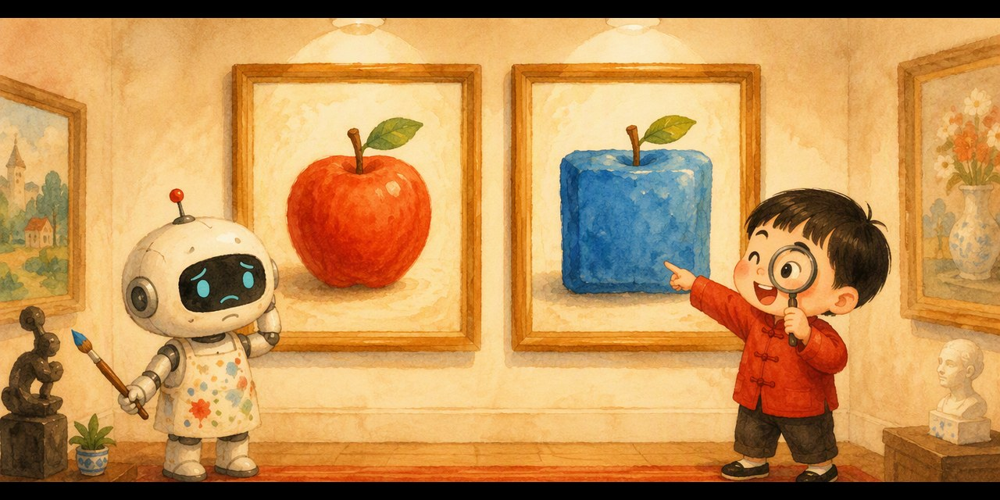

# 真假画廊 · 小评委大挑战（Spot the Fake）

> 一个造假，一个鉴假，互相较劲，一起变强——把 GAN 变成孩子的找茬游戏。

## 这是什么？

「和孩子一起学AI」社群 **AI十哲系列 · 第五课** 的配套游戏，把 2014 年古德费洛的经典论文 **生成对抗网络（GAN, Generative Adversarial Network）** 变成孩子能上手玩的找茬挑战：

- 🎨 **小画家（生成器 Generator）**：拼命画画，想骗过你的眼睛
- 🔍 **小评委（判别器 Discriminator）**：就是你！找出那幅藏着破绽的假画
- 💪 你每挑一次刺，小画家就改一笔——破绽越来越隐蔽，你也越练越毒

## 怎么玩？

1. 双击打开 `index.html`（手机、电脑都行，无需联网）
2. 两幅画并排挂上墙，**点你觉得是假的那一幅**
3. 三大展厅层层升级：

- 🍎 **苹果展厅**：破绽百出——方形？蓝色？找出来！
- 🐱 **小猫展厅**：破绽越来越隐蔽——胡子、耳朵、尾巴……
- 🏆 **大师决赛**：真假难分，最后一幅连你都可能会认错！

4. 集齐三枚徽章 🔍🏅👑，领取「**GAN 金牌对抗教练证书**」，截图发群里领奖状！

## 教育目标

- 理解 GAN 的核心机制：**生成器与判别器互相较劲、一起变强**
- 练出「判别器思维」：说出「哪里不对」，就是在做判别器的工作
- 安全教育：AI 换脸时代，网上看到的不一定是真的，奇怪的照片视频先找爸妈确认

## AI十哲系列游戏

| 课次 | 论文 | 游戏 | 仓库 |
| --- | --- | --- | --- |
| 第一课 | 感知机（1957） | 人类还是AI | [human-or-ai](https://github.com/pulj26pulj26/human-or-ai) |
| 第二课 | 图像识别 | 苹果还是不是苹果 | [apple-or-not](https://github.com/pulj26pulj26/apple-or-not) |
| 第三课 | LSTM（1997） | 记忆特工队·小本本大冒险 | [memory-agent](https://github.com/pulj26pulj26/memory-agent) |
| 第四课 | ResNet（2015） | 高速公路工程师·帮AI盖大楼 | [ai-highway](https://github.com/pulj26pulj26/ai-highway) |
| 第五课 | GAN（2014） | 真假画廊·小评委大挑战 | **spot-the-fake（本仓库）** |

## 本地运行

无需安装任何东西，双击 `index.html` 即可运行。也可以访问在线版：

**https://pulj26pulj26.github.io/spot-the-fake/**

---

Made with ❤️ by 和孩子一起学AI
